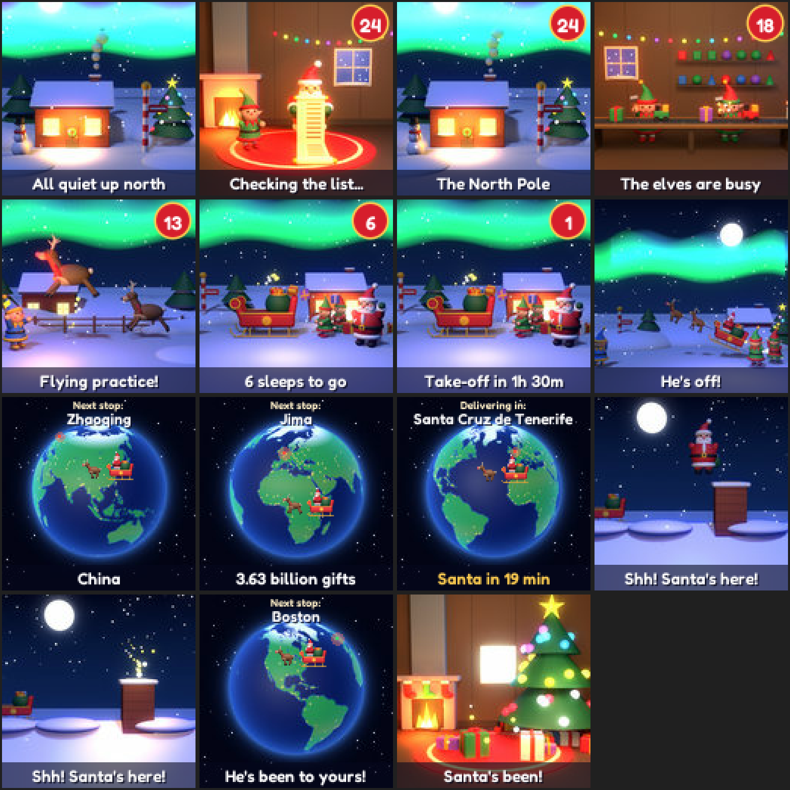

# Santa Tracker

A plugin for the Pimoroni Art Matrix: December at the North Pole, then Santa's flight
round the world on Christmas Eve, with a countdown to when he reaches your house.



| When | What's on |
| --- | --- |
| 1 December | Santa checks his list, and checks it twice. Names you give on the settings page turn up on it: "Holly: NICE!" |
| 5 December | The elves are busy in the workshop |
| 10 December | The reindeer practise flying |
| 18 December | The sleigh is loaded |
| Christmas Eve | A count down to take-off at 10:00 UTC, then he's off |
| The night | A globe turns to follow him from stop to stop, the sleigh facing the way he's going. Every stop he has made keeps a twinkling sparkle and the major cities a wrapped present, with the presents delivered so far and how long until he's at yours. Inside the last half hour: "Quick, into bed!" |
| Near you | When he flies into your part of the world the globe zooms in to a map of it, about 1800 km across with your house in the middle, and follows him town by town. It zooms back out when he has gone, and in again if he comes back |
| Around your house | From about ten minutes before your house it zooms in again, to a map of just your area. A smaller sleigh goes from town to town, up to twelve real towns near you, each closer than the last, with how far away he is in miles or kilometres. After his visit he calls at up to four more on his way out, then flies fast to rejoin the route. The route itself has him fly straight in and out, so this tour is the plugin's own |
| Your house | The map swoops in on your house and there he is on your roof, tossing the presents down the chimney: 14 seconds, then it swoops back out and he's off to the next town |
| Christmas Day | Christmas morning, presents under the tree |
| The rest of the year | A quiet North Pole under the northern lights, counting the sleeps |

Through December a bauble in the corner shows the sleeps left. Each day's newest scene
comes first, and the earlier ones stay in the rotation.

Your house is wherever the settings page's map says, or the Weather plugin's location if
you leave it blank. Nothing is fetched from the internet: the board's clock and the time
zone on its settings page are all the plugin needs. The settings page also has two ways
to try it before Christmas, both of which put a small "test" in the corner of the picture:

- **Demo of the whole story** plays everything in about three minutes, and repeats.
- **Pretend it's...** starts the clock at any date and time you give, at life's speed, a
  minute a second or ten minutes a second, with a button for each moment worth seeing:
  each stage of December, take-off, the flight, the minutes before he reaches your house,
  Christmas morning. Fast time slows down for his visit so you don't miss it.

## Installing

Copy the `santa_tracker` folder to `/lib/plugins/` on the board (3 MB, most of it the
films), then switch it on from the board's settings page. `tools/deploy.sh` does the
copying over USB with mpremote.

## Where things come from

- **The route** is the one in Google's Santa Tracker for Android,
  [`santa.json`](https://github.com/google/santa-tracker-android/blob/master/tracker/src/androidTest/res/raw/santa.json),
  Copyright 2019 Google LLC, under the Apache License 2.0 (see `LICENSE-route`).
  `tools/route.py` cuts it down to what the plugin needs, which changes it: each of its
  366 stops keeps its name, place, time and presents delivered, in `route.bin` and
  `route.txt`. Santa takes off at 10:00 UTC on 24 December and lands 25 hours later.
  He reaches your house when he reaches the stop nearest to it.
- **The globe's map**, its coasts, lakes and city lights, is drawn by `tools/earth.py`
  from [Natural Earth](https://www.naturalearthdata.com/) 1:110m data, which is in the
  public domain.
- **The close-up map** is drawn on the board from `land.bin`: Natural Earth 1:50m land,
  lakes and country boundaries (public domain), cut into 10 degree tiles by `tools/land.py`.
- **The towns** for his last stops are in `towns.bin`, packed by `tools/towns.py` from
  [GeoNames](https://www.geonames.org/) cities15000 (places of more than 15,000 people),
  which is licensed under Creative Commons Attribution 4.0.
- **The lettering** is Fredoka SemiBold, under the SIL Open Font License 1.1
  (`santa_tracker/OFL-Fredoka.txt`).
- **The films** were made for this plugin in Blender, from plain shapes.

## Making the films again

Everything on screen is built by script, so it can be changed and rendered again.
Needs Blender 5 and [uv](https://docs.astral.sh/uv/).

```
tools/build.sh            # every film, the globe and the sleigh
tools/build.sh workshop   # just one
```

- `tools/kit.py` is the toy box: Santa, elves, reindeer, the sleigh, presents, trees,
  cabins, snow, northern lights.
- `tools/scenes.py` builds each scene from the kit and poses it frame by frame. Every
  movement goes round a whole number of times, so each film loops.
- `tools/pack.py` adds the glow, shrinks the frames to 128 x 128 and packs them as a
  `.clip`: JPEG frames behind a table of where each starts.
